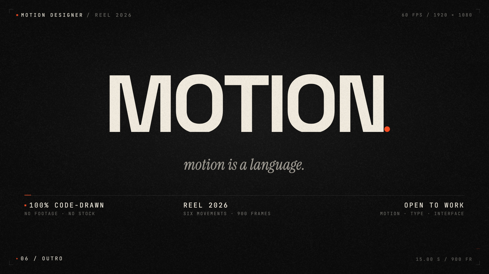

# MOTION. — 15 秒代码生成的动态设计 Showreel

**中文** · [English](#english) · [完整中文说明](README.zh-CN.md) · [Release v1.0.0](https://github.com/zazacheng-coder/motion-reel/releases/tag/v1.0.0)

一个朱红色圆点贯穿全片的 15 秒动态设计作品集短片。圆点变成横线、句点、橙色洪流、形态研究、按钮、3D 字体地形，最后成为标题的句号并飞回画面中心。第 899 帧与第 0 帧重合，可以无缝循环。

全片由代码绘制：字体、点阵、超椭圆形变、界面微交互、颗粒与纸张纹理，以及 120 BPM 的原创配乐，全部在工程内生成。没有实拍、图库素材或第三方音乐。

**▶ [看成片](out/motion-reel-1080p.mp4)** · [海报](out/motion-reel-poster.jpg) · [四格剧照](out/motion-reel-stills.jpg) · [创作 Brief](BRIEF.md) · [30 拍 Beat Map](BEATS.md)

[](out/motion-reel-1080p.mp4)

## 规格

| 项目 | 参数 |
|---|---|
| 时长 | 15.000 s（视频轨 900 帧） |
| 画幅 | 1920 × 1080（16:9） |
| 帧率 | 60 fps |
| 节奏 | 120 BPM，30 拍；drop 在 10.000 s |
| 声音 | 48 kHz 立体声原创配乐 + 音效；MP4 内 AAC 256k |
| 编码 | H.264，CRF 18，yuv420p，60fps |
| 循环 | 是 — 首帧与末帧是同一状态（圆点在 960,560，14px） |
| 字体 | Space Grotesk 300–700、Instrument Serif 400 + italic、JetBrains Mono 400–700（SIL OFL） |
| 文件 | 38 个文件；成片 31.8 MB |

## 六个乐章

1. **01 SIGNAL**（0–4.0s）— 圆点 → 横线 → MOTION → 动态字墙 → 收缩 → 橙色洪流。
2. **02 STATEMENT**（4.0–5.7s）— 橙色画面上的 MOVE / WITH / INTENT；画面随后收缩。
3. **03 FORM**（5.7–8.0s）— 纸张世界、点阵波纹、超椭圆形变与残影；形态缩成按钮，纸张抬起。
4. **04 INTERFACE**（7.83–10.0s）— 卡片、光标、点击、加载、对勾、SENT；按钮拉成贯穿画面的横线。
5. **05 IMPACT**（10.0–11.5s）— 硬切到 CSS 3D 字体地形，推进，扫描线揭开标题。
6. **06 OUTRO**（11.5–15.0s）— 标题、衬线副标题、简历信息块；句点脱离并飞回中心。

## 技术栈

Remotion 4 + React 19 + TypeScript。所有可见属性由 `useCurrentFrame()` 计算；弹簧、相机、遮罩、洪流都由帧号驱动，没有 CSS transition、timer 或 `Math.random()`。字体通过 `FontFace` + `delayRender` 本地加载；颗粒是按帧哈希偏移的程序化贴图，最后 12 帧冻结偏移以保证首尾一致；配乐用 numpy 合成 kick、clap、hat、sub bass、pad、arp、riser、impact 与 UI click。

## 真实声明

屏幕上的 `60 FPS`、`900 FRAMES`、`120 BPM`、`SIX MOVEMENTS`、`100% CODE-DRAWN`、`NO FOOTAGE · NO STOCK` 都是这个文件的真实属性。`OPEN TO WORK` 是短片里的虚构署名。没有编造客户、数据、引语或第三方 logo。

## 备注

- 字体为 SIL OFL 1.1，版权与来源见 [FONT-LICENSES.md](FONT-LICENSES.md) 与 [OFL.txt](OFL.txt)。代码和影片本身暂未声明开源许可，默认保留所有权利。
- 想改成你自己的简历：把 `MOTION.` 换成你的名字，修改 `src/components/Chrome.tsx`（页眉/页脚）和 `src/scenes/S6Outro.tsx`（结尾标题）；`OPEN TO WORK` 也在 `S6Outro.tsx` 的简历信息块里。

> 更完整的中文项目说明、源码结构和技术细节见 **[README.zh-CN.md](README.zh-CN.md)**。

---

## English

**MOTION. — a 15s showreel built in code**

A 15.000-second, 1920×1080, 60fps motion-design showreel. One vermilion dot opens the film, becomes a rule, a period, a flood, a form study, a button and the full stop, then returns to the same dot — frame 899 matches frame 0.

Everything is generated in the project: typography is set from bundled local fonts, the dot grid, type terrain, morphs and UI are React/CSS/SVG driven by the frame number, the film grain and paper textures are procedurally generated, and the score is synthesized from oscillators and noise. No footage, no stock, no third-party audio.

**▶ [Watch the film](out/motion-reel-1080p.mp4)** · [Poster frame](out/motion-reel-poster.jpg) · [Four-still sheet](out/motion-reel-stills.jpg)

### Specs

| | |
|---|---|
| Duration | 15.000 s |
| Frame | 1920 × 1080 (16:9) |
| FPS | 60 (900 frames) |
| Edit | 120 BPM, 30 beats, drop at 10.000 s |
| Audio | 48 kHz stereo original score + sound design, AAC 256k in the MP4 |
| Codec | H.264, CRF 18, yuv420p, 60fps |
| Loop | yes — first and last frame are the same state (dot at 960,560, 14px) |
| Type | Space Grotesk 300–700, Instrument Serif 400 + italic, JetBrains Mono 400–700 (all SIL OFL) |

### Movements

1. **01 SIGNAL** (0–4.0s) — dot → rule → MOTION → kinetic ticker → collapse → flood.
2. **02 STATEMENT** (4.0–5.7s) — MOVE / WITH / INTENT on vermilion; the field contracts.
3. **03 FORM** (5.7–8.0s) — paper field, dot-grid wave, a superellipse morph with ghost trails, the form shrinks to a button and the paper lifts.
4. **04 INTERFACE** (7.83–10.0s) — card, cursor, click, spinner, check, SENT, the button becomes a full-width rule.
5. **05 IMPACT** (10.0–11.5s) — hard cut to a CSS-3D terrain of MOTION, dolly, scan wipe.
6. **06 OUTRO** (11.5–15.0s) — the title, the serif line, the résumé block, the period detaches and loops home.

### Run it

```bash
npm install
npx tsc                       # typecheck
npm run dev                   # Remotion Studio (choose MotionReel)
npx remotion still MotionReel out/frame.png --frame=800
npm run render                # 1080p60 MP4 with audio
```

The rendered film and poster are already committed under `out/`, so you can watch it without installing anything.

Regenerate the procedural assets:

```bash
python3 tools/gen_assets.py   # grain.png, paper.jpg
python3 tools/gen_audio.py    # public/audio/reel-mix.wav
```

The Python scripts need Python 3 with `numpy` and `Pillow`.

### Source map

```
src/
  MotionReel.tsx          composition, scene stack, lighting, audio
  Root.tsx                Remotion registration (900f, 60fps)
  theme.ts                palette, type scale, margins, baseline, helpers
  lib/anim.ts             springs, bezier easings, progress helpers
  lib/shapes.ts           superellipse path sampler
  components/
    FontLoader.tsx        local FontFace loading with delayRender
    Chrome.tsx            crop marks, spec rails, live movement label
    Grain.tsx             deterministic film-grain tile drift
  scenes/
    S1Signal.tsx          0–240    dot, rule, title, ticker, collapse
    S2Statement.tsx       208–344  flood, MOVE WITH INTENT, contract
    S3Form.tsx            312–486  paper, dot grid, morph, sheet lift
    S4Interface.tsx       460–600  card, cursor, click, success, line
    S5Impact.tsx          600–702  type terrain, dolly, scan wipe
    S6Outro.tsx           688–900  title, résumé, period flight, loop
public/
  fonts/                  four WOFF2 files (latin subsets)
  textures/grain.png      generated 1024² grain tile
  textures/paper.jpg      generated 2048² paper
  audio/reel-mix.wav      15s 48kHz stereo score + SFX
tools/
  gen_assets.py
  gen_audio.py
BRIEF.md                  the six-block brief
BEATS.md                  the 30-beat map with sound events
```

### Determinism

Every visible property is computed from `useCurrentFrame()`. There are no CSS transitions, timers, `Math.random()` calls or frame-to-frame state. Grain offsets come from a hashed phase; the terrain wave is a pure sine of the frame. Fonts load through `delayRender`.

### Honest claims in the film

`60 FPS`, `900 FRAMES`, `120 BPM`, `SIX MOVEMENTS`, `100% CODE-DRAWN`, `NO FOOTAGE · NO STOCK` are all true of this file. `OPEN TO WORK` is the reel's in-fiction sign-off. No client, metric, quote or third-party logo is invented.

### Repository notes

`out/` contains the final 15s film, the poster and a four-still sheet. `node_modules/` is intentionally ignored. The bundled font files are OFL; see [FONT-LICENSES.md](FONT-LICENSES.md). The film itself is an original work by the repository owner.

### Credits / licences

- Type: Space Grotesk (Florian Karsten), Instrument Serif (Rodrigo Fuenzalida), JetBrains Mono (JetBrains) — SIL Open Font License.
- Score, sound design, textures and every moving mark: generated for this project.
